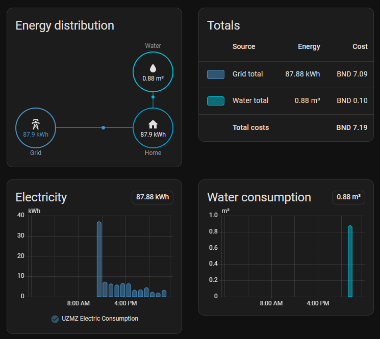

# UZMZ Home Assistant Integration

A Home Assistant custom integration for monitoring prepaid electric and water meters on USMS (Utility Smart Meter System) in Brunei.

> **Unofficial.** This is an independent open-source project. It is not affiliated with, endorsed by or supported by USMS or any utility provider. It reads the same pages you see when you log in to the USMS website. Use it at your own risk.


## Features

- 🔌 **Electric meter**: remaining units (kWh), balance (BND), meter status and USMS reading date
- 💧 **Water meter**: remaining units (m³), balance (BND), meter status and USMS reading date
- 🔐 **Captcha-aware login**: you sign in once in the Home Assistant UI (solving the USMS captcha if it shows one), then the integration keeps the session alive
- 🔁 **Automatic sign-in** (optional): with **Remember password** on, UZMZ signs in again by itself an hour after USMS ends the session, as long as USMS doesn't ask for a captcha
- 🔔 **Sign-in alerts**: a notification when USMS ends the session and you need to sign in again
- 📊 **History**: all sensors are recorded by Home Assistant for graphs and statistics
- 💵 **Top-up planner**: what you've topped up this month, the price your next top-up buys at, and how much more you can top up at that price
- 🔄 **Configurable polling**: default every hour

## Quick start

You need Home Assistant with [HACS](https://hacs.xyz/docs/use/) installed, and your USMS website login.

1. **Install:** click [](https://my.home-assistant.io/redirect/hacs_repository/?owner=danialothman&repository=uzmz-homeassistant&category=integration) → **Add**, then **Download**.
2. **Restart** Home Assistant (**Settings** → ⋮ → **Restart Home Assistant**).
3. **Add UZMZ:** click [](https://my.home-assistant.io/redirect/config_flow_start/?domain=uzmz)
4. **Sign in** with your USMS IC number and password, and turn on **Remember password** (see [why](#remember-password)). Type the captcha if USMS shows one.
5. **Optional:** add the [helper sensors](#helper-sensors-optional) for usage and cost, the [Energy dashboard](#energy-dashboard) and the ready-made [dashboard](#dashboard).

Then see [what to expect on the first day](#what-to-expect-on-the-first-day).

## Installation

### HACS (recommended)

[](https://my.home-assistant.io/redirect/hacs_repository/?owner=danialothman&repository=uzmz-homeassistant&category=integration)

The button opens UZMZ in your own Home Assistant's HACS. Or add it by hand:

1. In Home Assistant, open **HACS** → ⋮ → **Custom repositories**.
2. Add `https://github.com/danialothman/uzmz-homeassistant` with the type **Integration**.
3. Search for **UZMZ Utility Meter Monitor** in HACS and download it.
4. Restart Home Assistant.

### Manual

1. Copy `custom_components/uzmz` into your Home Assistant `config/custom_components/` folder.
2. Restart Home Assistant.

## Configuration

[](https://my.home-assistant.io/redirect/config_flow_start/?domain=uzmz)

1. Click the button, or go to **Settings** → **Devices & Services** → **Add Integration** and search for **UZMZ**.
2. Enter your USMS login:
   - **IC Number** and **Password**: the ones you use on the USMS website
   - **Remember password**: recommended, see [below](#remember-password); off by default
   - **Base URL**: optional, defaults to `https://www.usms.com.bn/SmartMeter/`
3. Type the captcha shown in the next step, if USMS shows one.

The integration signs in once and then keeps that session alive. USMS locks an account after 5 failed logins, so UZMZ only submits a login when you do, or once per ended session if you turn on [automatic sign-in](#automatic-sign-in).

### Remember password

**Turn it on**, unless you'd rather not keep your password in Home Assistant. USMS ends the session by itself about once a day. With **Remember password** on, UZMZ [signs in again by itself](#automatic-sign-in); with it off, you have to sign in again yourself every day or so. It's off by default because the password is then stored in Home Assistant; see [Privacy & security](#privacy--security). You can change it any time under [Options](#options).

### What to expect on the first day

None of these are faults:

- **A captcha** may appear when you sign in. Since October 2026 USMS usually skips it.
- **The helper counters start at 0** (usage, cost, Energy dashboard) and fill in from then on. They can't show the days before you installed them.
- **Days left** needs about a day of data.
- **Water usage arrives about a day late.** USMS posts it the next day, so today's water bar stays empty until then.
- **Electric hours can arrive late or in bulk.** USMS sometimes posts an hour late, so a bar is low and the next one catches up.
- **About once a day, one hour shows 0** and the next hour catches up. That's USMS ending the session and UZMZ waiting an hour before [signing in again](#automatic-sign-in).
- **The balance is an estimate between sign-ins.** It's worked out from your usage and the tariff, and resets to USMS's own figure at every sign-in, so it can shift by a few cents then.
- **Top-up price** shows unknown until UZMZ sees your first top-up of the month, or until the 1st. It can't see top-ups from before it was set up.

### When USMS asks you to sign in again

If the USMS session ends, the integration shows **Re-configuration required** under **Settings** → **Devices & Services**. Click **Reconfigure**, enter your password (or leave it blank if you chose **Remember password**), then type the captcha.

The USMS session ends when:

- you log in to USMS anywhere else, such as the website or app (USMS allows **one session per account**);
- USMS ends it by itself, which in October 2026 happened about once a day at random times, even overnight;
- the USMS site restarts;
- Home Assistant is offline for a while.

If you use the USMS website or app regularly, expect to sign in again in Home Assistant afterwards. Turning on **Remember password** means you don't type the password again, and turns on [automatic sign-in](#automatic-sign-in).

It also creates a **UZMZ — Sign-in required** notification (ID `uzmz_reauth_required`), which clears itself once you have signed in again. To get it on your phone, add an automation (replace `notify.mobile_app_your_phone` with your notify service):

```yaml
automation:
  - alias: "UZMZ sign-in required"
    triggers:
      - trigger: persistent_notification
        notification_id: uzmz_reauth_required
        update_type: added
    actions:
      - action: notify.mobile_app_your_phone
        data:
          title: "UZMZ — Sign-in required"
          message: "The USMS session ended (this happens when you sign in on the USMS website or app). Open Home Assistant and solve the captcha to resume meter readings."
          data:
            url: /config/integrations/integration/uzmz
```

### Automatic sign-in

Since October 2026 USMS often doesn't ask for a captcha. With **Remember password** on, when USMS ends the session UZMZ:

1. waits **an hour**, showing a **UZMZ — Signing in again soon** notification. USMS allows one session per account, so signing in straight away would log you out if you're using the USMS website or app (for example, to top up);
2. then signs in **once** with the saved password and replaces the notification with **UZMZ — Signed in again**.

If USMS asks for a captcha, or the attempt fails for any other reason, you get the usual **Sign-in required** notification and sign in yourself. If USMS rejects the saved password, automatic sign-in stays off until you sign in yourself, so it can never use up the 5 attempts before USMS locks the account.

Readings pause while it waits, and the usage reports fill in the gap afterwards. The example dashboard shows a **Signing in again soon** banner meanwhile. If Home Assistant restarts during the wait, it carries on from the same end time and still only tries once.

### Options

Go to **Settings** → **Devices & Services** → **UZMZ** → **Configure** to change:

- **Update interval**: how often to fetch meter data (300–86400 seconds, default 3600)
- **Remember password**: turning it off deletes the saved password immediately and turns off automatic sign-in; turning it on saves your password the next time you sign in

## Privacy & security

UZMZ only talks to the USMS website, over HTTPS with certificate checks. There is no other server, no telemetry and no analytics. Its requests say what they are: the User-Agent is `UZMZ/<version>` with a link to this repository, so USMS can tell the traffic apart and knows where to get in touch.

What is stored, in Home Assistant's own configuration storage (`config/.storage/core.config_entries`), like every other integration:

| Item | Stored? | Why |
|---|---|---|
| IC number | Yes | Needed to log in. It is never shown: not in the integration name, notifications, forms or logs. |
| USMS session cookie | Yes | Lets readings continue after a Home Assistant restart without solving a new captcha. While it is valid, it gives the same access as being logged in on the USMS website. |
| Password | **Only if you turn on Remember password** (off by default) | Lets UZMZ sign in again by itself, or you with just the captcha |

Things to know:

- Home Assistant stores integration data **unencrypted** on its own disk. Anyone with access to your Home Assistant files, or to an unencrypted Home Assistant backup, can read it. Keep backups private, or turn on backup encryption.
- Your password, IC number and session cookie are never written to the logs or to notifications. On a failed login only USMS's own error message is logged.
- UZMZ only submits a login when you do (setup or reauth), or once per ended session with [automatic sign-in](#automatic-sign-in), which stops for good if USMS rejects the saved password. So it can't lock your account: USMS locks accounts after 5 failed logins.
- Between sign-ins UZMZ only reads two pages: your meter page every polling interval, plus a light keep-alive every 5 minutes so the session doesn't time out.
- Removing the integration deletes everything it stored.

## Sensors

Entity IDs are generated from the device and sensor names. These are the defaults.

| Electric meter | Water meter | |
|---|---|---|
| `sensor.uzmz_electric_meter_electric_remaining_units` | `sensor.uzmz_water_meter_water_remaining_units` | Remaining units (kWh / m³) |
| `sensor.uzmz_electric_meter_electric_remaining_balance` | `sensor.uzmz_water_meter_water_remaining_balance` | Remaining balance (BND) |
| `sensor.uzmz_electric_meter_electric_meter_status` | `sensor.uzmz_water_meter_water_meter_status` | Meter status, e.g. `ACTIVE` |
| `sensor.uzmz_electric_meter_electric_last_updated` | `sensor.uzmz_water_meter_water_last_updated` | Date of the USMS reading |
| `sensor.uzmz_electric_meter_electric_usage_updated` | `sensor.uzmz_water_meter_water_usage_updated` | When USMS last posted new usage (see [USMS falling behind](#usms-falling-behind)) |
| `sensor.uzmz_electric_meter_electric_topped_up_this_month` | `sensor.uzmz_water_meter_water_topped_up_this_month` | B$ topped up this calendar month (see [Top-up prices](#top-up-prices)) |
| `sensor.uzmz_electric_meter_electric_top_up_price` | `sensor.uzmz_water_meter_water_top_up_price` | The price per kWh / m³ your next top-up buys at |
| `sensor.uzmz_electric_meter_electric_top_up_left_at_this_price` | `sensor.uzmz_water_meter_water_top_up_left_at_this_price` | B$ you can still top up at that price this month (none in the last band) |

The integration also has `sensor.uzmz_integration_last_refresh` (last successful sync) and `sensor.uzmz_integration_next_refresh`.

### When USMS updates its website

USMS's home page shows a platform version (6.1.1001 as of October 2026), which UZMZ reads on every sync at no extra cost. It's the diagnostic sensor `sensor.uzmz_integration_usms_platform_version`. A new version usually means USMS changed its website, and the last change (the captcha login) broke the integration.

When the version changes, UZMZ keeps working and creates a one-time **UZMZ — USMS website updated** notification (ID `uzmz_platform_changed`) naming the old and new versions. If readings then stop or look wrong, check HACS for an update or [open an issue](https://github.com/danialothman/uzmz-homeassistant/issues). To get it on your phone, use the [sign-in automation](#when-usms-asks-you-to-sign-in-again) with `notification_id: uzmz_platform_changed`.

USMS reports what is **left** on a prepaid meter, not what was used. The remaining-units sensors therefore can't be added to the Energy dashboard directly, because they drop as you use power and jump at every top-up. For the Energy dashboard, use the consumption and cost sensors from the [helper sensors](#helper-sensors-optional).

### How readings stay current

USMS's home page keeps showing the readings from the moment you signed in, for as long as the session lasts. Its usage reports, however, are live. So UZMZ:

1. Records the remaining units and balance at sign-in, together with the usage the reports show at that moment.
2. On every update, adds up the usage reported since then:
   - electricity hour by hour;
   - water day by day, including days USMS posts late.
3. Shows **remaining units = units at sign-in − usage since**. This matches what USMS shows after a fresh sign-in.
4. Shows **balance = balance at sign-in − cost of the usage since**. This is an **estimate**, and it returns to USMS's exact figure at every sign-in. The cost comes from [what your units cost when you bought them](#top-up-prices).

The balance sensors show how each reading was calculated in their attributes: `estimated`, `balance_method` (`top-up prices`, `learned rate` or `average rate`), `rate` (what the units you're using now cost), `price_layers` (the units left at each price, oldest first), `used_since_sign_in`, `month_to_date` (this month's usage, for information), `sign_in_units`, `sign_in_balance`, `sign_in_date`, `rate_is_average`. `approximate` is true when the sign-in time wasn't known, for example right after upgrading from an older version.

### Top-up prices

On a prepaid meter you pay when you **top up**, not when you use the units. The tariff bands apply to how much you've topped up in the calendar month, and restart on the 1st:

| Electricity ([DES residential tariff](https://www.des.gov.bn/electricity-tariff/)), units bought this month | Price |
|---|---|
| first 600 kWh (the first B$6) | B$0.01/kWh |
| 601–2,000 kWh (up to B$118 in total) | B$0.08/kWh |
| 2,001–4,000 kWh (up to B$318) | B$0.10/kWh |
| above 4,000 kWh | B$0.12/kWh |

| Water ([listed by USMS](https://www.usms.com.bn/web/tariffs/)), units bought this month | Price |
|---|---|
| first 54.54 m³ (the first B$6) | B$0.11/m³ |
| above 54.54 m³ | B$0.44/m³ |

For example, a B$30 water top-up early in the month buys 54.54 m³ at B$0.11 and then 54.5 m³ at B$0.44. Topping up B$6 a month instead keeps all your water at B$0.11. The water band is per unit in the building, so UZMZ assumes a house (one unit).

Your balance is what your remaining units cost, and USMS uses the oldest units first. UZMZ follows this:

- It keeps the units left at each price, and checks them against USMS's balance at every sign-in.
- A **top-up** (units and balance up by more than your usage explains) adds units at the prices that month's top-ups so far give them. UZMZ only sees a top-up at the next sign-in. A top-up on the USMS website or app ends UZMZ's session, so that's within the hour with automatic sign-in on.
- When it first starts, or if its figures no longer match USMS's balance, it works the prices out from the balance per unit.

The **top-up planner** sensors (in the [table above](#sensors)) show what you've topped up this month, the price your next top-up starts at, and how much more you can top up at that price. They're unknown until UZMZ has seen a top-up this month, or from the 1st. To try other amounts, the unofficial [USMS Calculator](https://usmscalculator.brunei.app/topup) works the same way.

**After a top-up**, the readings don't include it until the next sign-in. To sign in straight away, go to **Settings** → **Devices & Services** → **UZMZ** → ⋮ → **Reconfigure** and solve the captcha.

## Helper sensors (optional)

[`examples/uzmz_package.yaml`](examples/uzmz_package.yaml) is a Home Assistant [package](https://www.home-assistant.io/docs/configuration/packages/) of extra sensors built on UZMZ's:

| Sensor | What it shows |
|---|---|
| `sensor.uzmz_electric_consumption` / `sensor.uzmz_water_consumption` | kWh / m³ used. They add up every drop in remaining units and ignore top-ups. |
| `sensor.uzmz_electric_cost` / `sensor.uzmz_water_cost` | BND spent. They add up every drop in balance and ignore top-ups. |
| `sensor.uzmz_electric_days_left` / `sensor.uzmz_water_days_left` | Days of credit left at the last 7 days' average use |
| `sensor.uzmz_electric_summary` / `sensor.uzmz_water_summary` | Balance and units on one line, e.g. `220.12 BND · 2422 kWh` |
| `binary_sensor.uzmz_sign_in_required` | On while USMS needs you to sign in again |
| `binary_sensor.uzmz_signing_in_again` | On while UZMZ waits to sign in again by itself ([automatic sign-in](#automatic-sign-in)); its `message` attribute says when |

To install:
1. Add `homeassistant: packages: !include_dir_named packages` to `configuration.yaml`.
2. Copy the file to `config/packages/uzmz.yaml`.
3. Restart Home Assistant.

The counters start at 0 and fill in from then on. Days left needs about a day of data.

### Energy dashboard

With the helper sensors installed, go to **Settings** → **Dashboards** → **Energy** and add:

- **Electricity grid**:
  - **Grid consumption**: `sensor.uzmz_electric_consumption`
  - **Cost**: choose **Use an entity tracking the total costs**, then `sensor.uzmz_electric_cost`
- **Water consumption**:
  - **Consumption**: `sensor.uzmz_water_consumption`
  - **Cost**: `sensor.uzmz_water_cost`

You then get daily, weekly and monthly usage and spend. The costs follow the tariff, because they come from the balance itself rather than a fixed price.



## Dashboard

[`lovelace-dashboard.yaml`](lovelace-dashboard.yaml) is a ready-made **Utility Meters** view. It needs the [helper sensors](#helper-sensors-optional). It has:

- **Status**:
  - **Banners**: "sign-in required" and "can't reach USMS", each shown only when it applies.
  - **Sync times**: when UZMZ last synced and when it syncs next.
  - **Sync now**: a button for an immediate update.
- **Electric and Water**:
  - **Balance gauge**: red and yellow at the USMS SMS-alert levels.
  - **Readings**: remaining units, days left, meter status, the USMS reading date, and the [top-up planner](#top-up-prices).
- **Usage**:
  - **Daily charts**: kWh and m³ used per day.
  - **Balance charts**: 30-day electric and water balance.

To add it, create a dashboard under **Settings** → **Dashboards**, open it, choose **Edit** → ⋮ → **Raw configuration editor**, and paste the file in.

## Automation examples

### Low balance alert

The thresholds below match the USMS SMS alerts (electric 15 BND, water 5 BND).

```yaml
automation:
  - alias: "UZMZ low balance"
    triggers:
      - trigger: numeric_state
        entity_id: sensor.uzmz_electric_meter_electric_remaining_balance
        below: 15
        id: Electric
      - trigger: numeric_state
        entity_id: sensor.uzmz_water_meter_water_remaining_balance
        below: 5
        id: Water
    conditions:
      # Coming back from unavailable (e.g. after a sign-in) isn't a new drop.
      - condition: template
        value_template: "{{ trigger.from_state.state not in ['unavailable', 'unknown'] }}"
    actions:
      - action: notify.mobile_app_your_phone
        data:
          title: "UZMZ — {{ trigger.id }} balance low"
          message: "{{ trigger.id }} balance is {{ trigger.to_state.state }} BND. Time to top up."
```

### USMS falling behind

USMS sometimes stops posting meter readings for a while; the integration can't fix that, but it can tell you. The **Usage Updated** sensors record when UZMZ last saw new usage in USMS's reports, checked at every sync (hourly by default) and kept across restarts. Electricity normally updates every hour; water a day or more late. They stay unknown until the first change after installing.

This alerts when electricity hasn't updated for 6 hours or water for 3 days (adjust to taste):

```yaml
automation:
  - alias: "UZMZ readings stale"
    triggers:
      - trigger: template
        value_template: >
          
          {{ t is not none and now() - t > timedelta(hours=6) }}
        id: electric
      - trigger: template
        value_template: >
          
          {{ t is not none and now() - t > timedelta(days=3) }}
        id: water
    actions:
      - action: notify.mobile_app_your_phone
        data:
          title: "UZMZ — USMS readings are late"
          message: >
            USMS hasn't posted new {{ trigger.id }} usage in
            {{ states('sensor.uzmz_' ~ trigger.id ~ '_meter_' ~ trigger.id ~ '_usage_updated') | as_datetime | relative_time }}.
            Balances are estimates until it catches up.
```

### Daily report

```yaml
automation:
  - alias: "UZMZ daily report"
    triggers:
      - trigger: time
        at: "20:00:00"
    actions:
      - action: notify.mobile_app_your_phone
        data:
          title: "Daily utility report"
          message: >
            Electric: {{ states('sensor.uzmz_electric_meter_electric_remaining_units') }} kWh
            ({{ states('sensor.uzmz_electric_meter_electric_remaining_balance') }} BND)
            Water: {{ states('sensor.uzmz_water_meter_water_remaining_units') }} m³
            ({{ states('sensor.uzmz_water_meter_water_remaining_balance') }} BND)
```

## Limitations

UZMZ is tested with one USMS account that has one electric and one water meter, so that's what it supports:

- **One USMS account per Home Assistant.** Adding a second account stops with a message rather than half-working. Managing two homes on separate accounts (for example, your parents' house) isn't supported yet.
- **One electric and one water meter per account.** If an account has more, UZMZ shows the first of each type, ignores the rest, and says so in a **UZMZ — Some meters aren't shown** notification.

If you need either, please [open an issue](https://github.com/danialothman/uzmz-homeassistant/issues). For extra meters, a screenshot of the USMS home page with your name, IC number and account details blurred helps a lot: UZMZ has never seen that layout.

## Troubleshooting

- **Invalid credentials**: check that you can log in on the USMS website with the same IC number and password. Stop after a couple of failures, because USMS locks the account after 5.
- **Wrong captcha**: a new captcha is shown automatically; type the new one.
- **No data or sensors unavailable**: check the Home Assistant logs and that the USMS website is up. If the session ended, follow [When USMS asks you to sign in again](#when-usms-asks-you-to-sign-in-again).
- **The integration broke after a USMS website change**: check whether `sensor.uzmz_integration_usms_platform_version` changed, then please [open an issue](https://github.com/danialothman/uzmz-homeassistant/issues). Developers can use `scripts/live_test.py` to test the client against the live site (see `CLAUDE.md`).

### Debug logging

```yaml
logger:
  default: info
  logs:
    custom_components.uzmz: debug
```

## Contributing

Issues and pull requests are welcome at [github.com/danialothman/uzmz-homeassistant](https://github.com/danialothman/uzmz-homeassistant).

## License

[MIT](LICENSE)

## Credits

Based on the original UZMZ Python script for utility meter monitoring.
