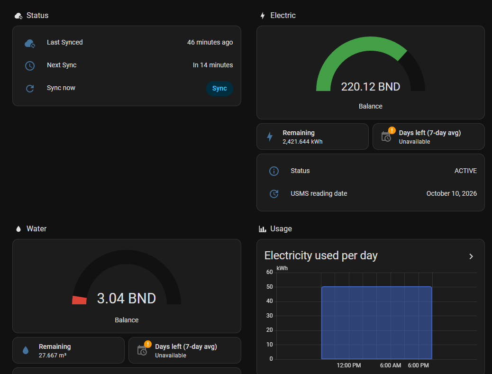

# UZMZ Home Assistant Integration

A Home Assistant custom integration for monitoring prepaid electric and water meters on USMS (Utility Smart Meter System) in Brunei.

> **Unofficial.** This is an independent open-source project. It is not affiliated with, endorsed by or supported by USMS or any utility provider. It reads the same pages you see when you log in to the USMS website. Use it at your own risk.



## Features

- 🔌 **Electric meter**: remaining units (kWh), balance (BND), meter status and USMS reading date
- 💧 **Water meter**: remaining units (m³), balance (BND), meter status and USMS reading date
- 🔐 **Captcha-aware login**: you solve the USMS captcha once in the Home Assistant UI, then the integration keeps the session alive
- 🔔 **Sign-in alerts**: a notification when USMS ends the session and you need to sign in again
- 📊 **History**: all sensors are recorded by Home Assistant for graphs and statistics
- 🔄 **Configurable polling**: default every hour

## Installation

### HACS (recommended)

1. In Home Assistant, open **HACS** → ⋮ → **Custom repositories**.
2. Add `https://github.com/danialothman/uzmz-homeassistant` with the type **Integration**.
3. Search for **UZMZ Utility Meter Monitor** in HACS and download it.
4. Restart Home Assistant.

### Manual

1. Copy `custom_components/uzmz` into your Home Assistant `config/custom_components/` folder.
2. Restart Home Assistant.

## Configuration

1. Go to **Settings** → **Devices & Services** → **Add Integration** and search for **UZMZ**.
2. Enter your USMS login:
   - **IC Number** and **Password**: the ones you use on the USMS website
   - **Remember password**: off by default; see [Privacy & security](#privacy--security)
   - **Base URL**: optional, defaults to `https://www.usms.com.bn/SmartMeter/`
3. Type the captcha shown in the next step.

USMS asks for a captcha at every login, so the integration signs in once and then keeps that session alive. It never logs in on its own. USMS locks an account after 5 failed logins, so it only ever submits a login when you do.

### When USMS asks you to sign in again

If the USMS session ends, the integration shows **Re-configuration required** under **Settings** → **Devices & Services**. Click **Reconfigure**, enter your password (or leave it blank if you chose **Remember password**), then type the captcha.

USMS allows **one session per account**, so the session ends when:

- you log in to USMS anywhere else, such as the website or app;
- the USMS site restarts;
- Home Assistant is offline for a while.

If you use the USMS website or app regularly, expect to sign in again in Home Assistant afterwards. Turning on **Remember password** makes that a captcha-only step.

It also creates a **UZMZ — Sign-in required** notification (ID `uzmz_reauth_required`), which clears itself once you have signed in again. To get it on your phone, add an automation (replace `notify.mobile_app_your_phone` with your notify service):

```yaml
automation:
  - alias: "UZMZ sign-in required"
    triggers:
      - trigger: persistent_notification
        notification_id: uzmz_reauth_required
        update_type: added
    actions:
      - action: notify.mobile_app_your_phone
        data:
          title: "UZMZ — Sign-in required"
          message: "The USMS session ended (this happens when you sign in on the USMS website or app). Open Home Assistant and solve the captcha to resume meter readings."
          data:
            url: /config/integrations/integration/uzmz
```

### Options

Go to **Settings** → **Devices & Services** → **UZMZ** → **Configure** to change:

- **Update interval**: how often to fetch meter data (300–86400 seconds, default 3600)
- **Remember password**: turning it off deletes the saved password immediately; turning it on saves your password the next time you sign in

## Privacy & security

UZMZ only talks to the USMS website, over HTTPS with certificate checks. There is no other server, no telemetry and no analytics.

What is stored, in Home Assistant's own configuration storage (`config/.storage/core.config_entries`), like every other integration:

| Item | Stored? | Why |
|---|---|---|
| IC number | Yes | Needed to log in. It is never shown: not in the integration name, notifications, forms or logs. |
| USMS session cookie | Yes | Lets readings continue after a Home Assistant restart without solving a new captcha. While it is valid, it gives the same access as being logged in on the USMS website. |
| Password | **Only if you turn on Remember password** (off by default) | Lets you sign in again with just the captcha |

Things to know:

- Home Assistant stores integration data **unencrypted** on its own disk. Anyone with access to your Home Assistant files, or to an unencrypted Home Assistant backup, can read it. Keep backups private, or turn on backup encryption.
- Your password, IC number and session cookie are never written to the logs or to notifications. On a failed login only USMS's own error message is logged.
- UZMZ never logs in by itself. It only submits a login when you do (setup or reauth), so it cannot lock your account. USMS locks accounts after 5 failed logins.
- Between sign-ins UZMZ only reads two pages: your meter page every polling interval, plus a light keep-alive every 5 minutes so the session doesn't time out.
- Removing the integration deletes everything it stored.

## Sensors

Entity IDs are generated from the device and sensor names. These are the defaults.

| Electric meter | Water meter | |
|---|---|---|
| `sensor.uzmz_electric_meter_electric_remaining_units` | `sensor.uzmz_water_meter_water_remaining_units` | Remaining units (kWh / m³) |
| `sensor.uzmz_electric_meter_electric_remaining_balance` | `sensor.uzmz_water_meter_water_remaining_balance` | Remaining balance (BND) |
| `sensor.uzmz_electric_meter_electric_meter_status` | `sensor.uzmz_water_meter_water_meter_status` | Meter status, e.g. `ACTIVE` |
| `sensor.uzmz_electric_meter_electric_last_updated` | `sensor.uzmz_water_meter_water_last_updated` | Date of the USMS reading |

The integration also has `sensor.uzmz_integration_last_refresh` (last successful sync) and `sensor.uzmz_integration_next_refresh`.

USMS reports what is **left** on a prepaid meter, not what was used. The remaining-units sensors therefore can't be added to the Energy dashboard directly, because they drop as you use power and jump at every top-up. For the Energy dashboard, use the consumption and cost sensors from the [helper sensors](#helper-sensors-optional).

### How readings stay current

USMS's home page keeps showing the readings from the moment you signed in, for as long as the session lasts. Its usage reports, however, are live. So UZMZ:

1. Records the remaining units and balance at sign-in, together with the usage the reports show at that moment.
2. On every update, adds up the usage reported since then:
   - electricity hour by hour;
   - water day by day, including days USMS posts late.
3. Shows **remaining units = units at sign-in − usage since**. This matches what USMS shows after a fresh sign-in.
4. Shows **balance = balance at sign-in − cost of the usage since**. This is an **estimate**, and it returns to USMS's exact figure at every sign-in.
   - **Electricity** is costed with the [DES residential tariff](https://www.des.gov.bn/electricity-tariff/):

     | Monthly usage | Rate |
     |---|---|
     | 1–600 kWh | B$0.01/kWh |
     | 601–2,000 kWh | B$0.08/kWh |
     | 2,001–4,000 kWh | B$0.10/kWh |
     | above 4,000 kWh | B$0.12/kWh |

     Each kWh is charged in the band it falls in, using this month's total so far from the reports. The count restarts on the 1st.
   - **Water** is costed with the domestic water tariff [listed by USMS](https://www.usms.com.bn/web/tariffs/):

     | Monthly usage | Rate |
     |---|---|
     | first 54.54 m³ | B$0.11/m³ |
     | above 54.54 m³ | B$0.44/m³ |

     The band is per unit in the building, so UZMZ assumes a house (one unit).

The balance sensors show how each reading was calculated in their attributes: `estimated`, `balance_method` (`tariff`, `learned rate` or `average rate`), `used_since_sign_in`, `month_to_date`, `sign_in_units`, `sign_in_balance`, `sign_in_date`, `rate` (for electricity, the current band's rate), `rate_is_average`. `approximate` is true when the sign-in time wasn't known, for example right after upgrading from an older version.

**After a top-up**, the readings don't include it until the next sign-in. To sign in straight away, go to **Settings** → **Devices & Services** → **UZMZ** → ⋮ → **Reconfigure** and solve the captcha.

## Helper sensors (optional)

[`examples/uzmz_package.yaml`](examples/uzmz_package.yaml) is a Home Assistant [package](https://www.home-assistant.io/docs/configuration/packages/) of extra sensors built on UZMZ's:

| Sensor | What it shows |
|---|---|
| `sensor.uzmz_electric_consumption` / `sensor.uzmz_water_consumption` | kWh / m³ used. They add up every drop in remaining units and ignore top-ups. |
| `sensor.uzmz_electric_cost` / `sensor.uzmz_water_cost` | BND spent. They add up every drop in balance and ignore top-ups. |
| `sensor.uzmz_electric_days_left` / `sensor.uzmz_water_days_left` | Days of credit left at the last 7 days' average use |
| `sensor.uzmz_electric_summary` / `sensor.uzmz_water_summary` | Balance and units on one line, e.g. `220.12 BND · 2422 kWh` |
| `binary_sensor.uzmz_sign_in_required` | On while USMS needs you to sign in again |

To install:
1. Add `homeassistant: packages: !include_dir_named packages` to `configuration.yaml`.
2. Copy the file to `config/packages/uzmz.yaml`.
3. Restart Home Assistant.

The counters start at 0 and fill in from then on. Days left needs about a day of data.

### Energy dashboard

With the helper sensors installed, go to **Settings** → **Dashboards** → **Energy** and add:

- **Electricity grid**:
  - **Grid consumption**: `sensor.uzmz_electric_consumption`
  - **Cost**: choose **Use an entity tracking the total costs**, then `sensor.uzmz_electric_cost`
- **Water consumption**:
  - **Consumption**: `sensor.uzmz_water_consumption`
  - **Cost**: `sensor.uzmz_water_cost`

You then get daily, weekly and monthly usage and spend. The costs follow the tariff, because they come from the balance itself rather than a fixed price.

## Dashboard

[`lovelace-dashboard.yaml`](lovelace-dashboard.yaml) is a ready-made **Utility Meters** view. It needs the [helper sensors](#helper-sensors-optional). It has:

- **Status**:
  - **Banners**: "sign-in required" and "can't reach USMS", each shown only when it applies.
  - **Sync times**: when UZMZ last synced and when it syncs next.
  - **Sync now**: a button for an immediate update.
- **Electric and Water**:
  - **Balance gauge**: red and yellow at the USMS SMS-alert levels.
  - **Readings**: remaining units, days left, meter status, and the USMS reading date.
- **Usage**:
  - **Daily charts**: kWh and m³ used per day.
  - **Balance charts**: 30-day electric and water balance.

To add it, create a dashboard under **Settings** → **Dashboards**, open it, choose **Edit** → ⋮ → **Raw configuration editor**, and paste the file in.

## Automation examples

### Low balance alert

The thresholds below match the USMS SMS alerts (electric 15 BND, water 5 BND).

```yaml
automation:
  - alias: "UZMZ low balance"
    triggers:
      - trigger: numeric_state
        entity_id: sensor.uzmz_electric_meter_electric_remaining_balance
        below: 15
        id: Electric
      - trigger: numeric_state
        entity_id: sensor.uzmz_water_meter_water_remaining_balance
        below: 5
        id: Water
    conditions:
      # Coming back from unavailable (e.g. after a sign-in) isn't a new drop.
      - condition: template
        value_template: "{{ trigger.from_state.state not in ['unavailable', 'unknown'] }}"
    actions:
      - action: notify.mobile_app_your_phone
        data:
          title: "UZMZ — {{ trigger.id }} balance low"
          message: "{{ trigger.id }} balance is {{ trigger.to_state.state }} BND. Time to top up."
```

### Daily report

```yaml
automation:
  - alias: "UZMZ daily report"
    triggers:
      - trigger: time
        at: "20:00:00"
    actions:
      - action: notify.mobile_app_your_phone
        data:
          title: "Daily utility report"
          message: >
            Electric: {{ states('sensor.uzmz_electric_meter_electric_remaining_units') }} kWh
            ({{ states('sensor.uzmz_electric_meter_electric_remaining_balance') }} BND)
            Water: {{ states('sensor.uzmz_water_meter_water_remaining_units') }} m³
            ({{ states('sensor.uzmz_water_meter_water_remaining_balance') }} BND)
```

## Troubleshooting

- **Invalid credentials**: check that you can log in on the USMS website with the same IC number and password. Stop after a couple of failures, because USMS locks the account after 5.
- **Wrong captcha**: a new captcha is shown automatically; type the new one.
- **No data or sensors unavailable**: check the Home Assistant logs and that the USMS website is up. If the session ended, follow [When USMS asks you to sign in again](#when-usms-asks-you-to-sign-in-again).
- **The integration broke after a USMS website change**: please [open an issue](https://github.com/danialothman/uzmz-homeassistant/issues). Developers can use `scripts/live_test.py` to test the client against the live site (see `CLAUDE.md`).

### Debug logging

```yaml
logger:
  default: info
  logs:
    custom_components.uzmz: debug
```

## Contributing

Issues and pull requests are welcome at [github.com/danialothman/uzmz-homeassistant](https://github.com/danialothman/uzmz-homeassistant).

## License

[MIT](LICENSE)

## Credits

Based on the original UZMZ Python script for utility meter monitoring.
